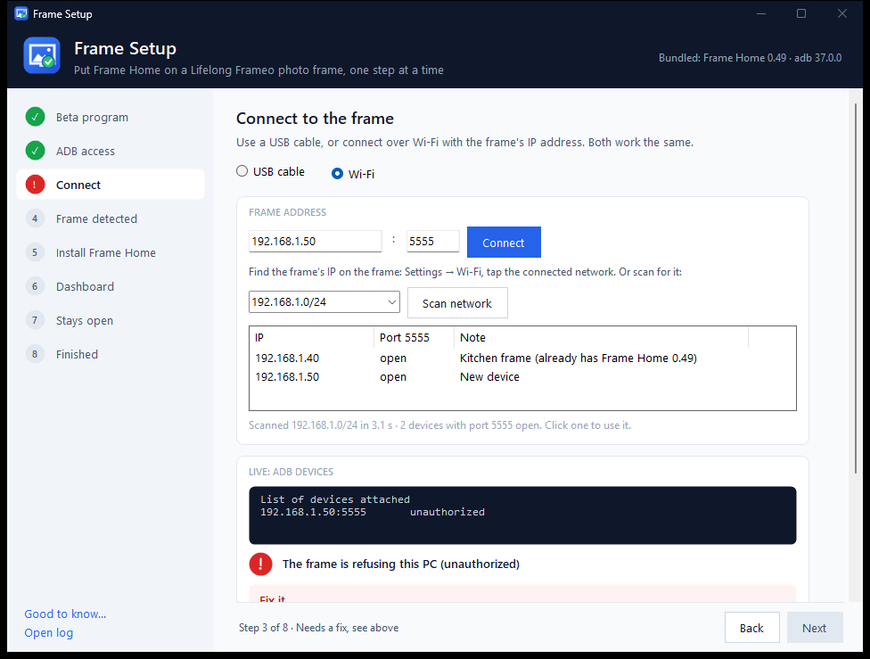

# Frame Setup

Frame Setup is a small Windows wizard that puts **Frame Home**, a custom home-screen app, on a Lifelong Frameo photo frame. It takes you through the job one step at a time, checks each step, and tells you how to fix anything that goes wrong.

It's a single small exe with no installer. It runs on the .NET Framework 4.8 that comes with Windows 10 and 11.



All screenshots use made-up example data.

**Status:** the screens and the live adb and dashboard checks have been tested. The full install hasn't been run on a real frame yet.

## What you need

| You need | Why |
|---|---|
| A Windows 10 or 11 PC | Runs the wizard and builds it. No other compiler is needed. |
| A Lifelong Frameo frame | The wizard was made for these frames (rk312x, Android 6). Other models may not work. |
| [Android platform-tools](https://developer.android.com/tools/releases/platform-tools) | Provides `adb`, the tool the PC uses to talk to the frame. |
| `FrameHome.apk`, plus the Frame Home source folder | The app that gets installed. **It isn't in this repo.** The build also reads its version from `app\build.gradle.kts` in that folder. |
| A Frame Home dashboard | A server on your network that frames check in with. The wizard uses it to confirm the frame works. |
| The frame and PC on the same network, or a USB cable | So they can reach each other. |

## Build it

1. Download or clone this repo.
2. By default, the build looks for platform-tools in `C:\Program Files\platform-tools` and for the Frame Home folder next to this one, at `..\FrameHome`. If yours are elsewhere, set these first, using your own paths:

   ```
   set PLATFORM_TOOLS=C:\path\to\platform-tools
   set FRAMEHOME=C:\path\to\FrameHome
   ```

3. Optional: to fill in your own dashboard address, create a file called `local-default-server.txt` in this folder containing just the address, for example `http://192.168.1.100:8100`. Git ignores this file, so it's never uploaded.
4. Run:

   ```
   build.cmd
   ```

Everything ends up in the `dist` folder. To use the wizard on another PC, copy the whole `dist` folder.

## Use it

Open `dist\FrameSetup.exe` and work down the steps on the left. **Next** unlocks when a step passes. You can click any step to go back to it.

### 1. Beta program

The frame only offers ADB access once this is on. You do this on the frame, because the PC can't check it yet:

1. On the frame, tap the photo and open **Settings**.
2. Open **About** and turn on **Beta program**.
3. If an update is offered, install it.
4. Tick the box in the wizard.

### 2. ADB access

This is what lets the PC install apps on the frame:

1. On the frame, open **Settings → About** and turn on **ADB access**.
2. If it's already on, turn it off and on again.
3. Tick the box in the wizard.

### 3. Connect

Choose **USB cable** or **Wi-Fi**. For Wi-Fi, type the frame's IP address and press **Connect**, or press **Scan network** to look for devices with port 5555 open, then click one. The frame's IP is under **Settings → Wi-Fi** on the frame.

The box below shows the live `adb devices` result:

| What you see | What it means | What to do |
|---|---|---|
| Nothing found | The PC can't see the frame yet. | Check the cable or IP address. |
| **unauthorized** | The frame hasn't allowed this PC. | Turn ADB access off and on, tick **Always allow** on the frame's prompt and tap OK. If no prompt appears, press **Restart ADB**. |
| **offline** | The connection is stuck. | Turn ADB access off and on, then press **Restart ADB**. |
| **device** | Connected. | Press **Next**. |

### 4. Frame detected

This reads the frame's model, Android version, screen size, memory, Wi-Fi address and any installed Frame Home version. It also checks whether root works, for information only. Nothing is changed.

### 5. Install Frame Home

Press **Install**. The wizard installs the APK, retrying once if the known "failed to read copy response: EOF" error appears. It then confirms the version and opens Frame Home on the frame.

### 6. Dashboard

Check the dashboard address, then wait. The wizard asks the dashboard every 5 seconds until this frame shows online with the right version. If it hasn't appeared after 2 minutes, set the address on the frame: long-press the photo, open **Settings**, enter the dashboard address and save.

### 7. Stays open (optional)

This tests that Frame Home comes back by itself after a restart:

- **Restart the frame** restarts it from the PC.
- **I'll restart it myself** is for when ADB is locked. Unplug the frame for 5 seconds, plug it back in, and press this button straight away.
- **Skip** moves on without testing.

The frame takes about **4–5 minutes** to come back, which is normal. The wizard watches the dashboard instead of ADB, because ADB locks again after a restart.

### 8. Finished

You get a summary, plus **Open dashboard** and **Set up another**.

## Good to know

- **ADB gets locked again.** Frameo clears the PC's access whenever the frame restarts or Frameo comes to the front. Turn ADB access off and on again to get it back.
- **The wizard never taps the frame's screen.** ADB taps can register as long-presses on these frames, so you do the tapping.
- **No system files are changed.** Frame Home is a normal app install, and nothing under `/system` is touched.
- **Root isn't required** by any step. The wizard only reports whether it works.

## Commands the wizard runs

| When | Command | Why |
|---|---|---|
| Start | `adb version`, `adb start-server` | Shows the adb version and starts adb. |
| Connect | `adb devices` (every 2 seconds) | Shows the live connection state. |
| Connect, Wi-Fi | `adb connect IP:PORT` | Connects to the frame. |
| Restart ADB button | `adb kill-server`, `adb start-server` | Restarts adb, then reconnects on Wi-Fi. This also drops adb connections to any other devices on this PC. |
| Scan network | A TCP connection attempt to port 5555 on every address in the /24 | Finds devices with ADB open. |
| Frame detected | `getprop`, `wm size`, `cat /proc/meminfo`, `ip -f inet addr show wlan0`, `su -c id`, `dumpsys package com.framehome.app` | Reads information only. |
| Install | `adb install -r FrameHome.apk` | Installs or updates the app. |
| Install | `am start -n com.framehome.app/.MainActivity` | Opens the app. |
| Restart test | `adb reboot` | Restarts the frame. |
| Dashboard, restart test | `GET {dashboard}/api/frames` | Checks whether the frame is online and which version it runs. |

## What each file does

| File or folder | What it does |
|---|---|
| `build.cmd` | Compiles the app with Windows' built-in C# compiler and copies adb and the APK into `dist`. |
| `src/WizardForm.cs` | The main window, all eight steps and their checks, saved settings, the log and the test options. |
| `src/Adb.cs` | Runs adb, reads its output, scans the network and reads the dashboard. |
| `src/Ui.cs` | Colours, fonts and the custom controls: cards, status icons, the step list and fix-it boxes. |
| `src/Logo.cs` | Draws the logo in code. |
| `src/MakeIcon.cs` | A small build-time tool that turns the logo into the icon files. |
| `src/app.manifest` | Tells Windows the app is DPI-aware and doesn't need admin rights. |
| `assets/` | The generated `app.ico` and `logo.png`. |
| `docs/` | The screenshots in this README. |
| `mockup/index.html` | The clickable design mockup. Open it in a browser. It isn't used by the app. |
| `.gitignore` | Keeps build output, adb, the APK and your local address out of Git. |

**Created when you build, and not in this repo:**

| File | What it does |
|---|---|
| `dist/FrameSetup.exe` | The app. |
| `dist/adb.exe`, `AdbWinApi.dll`, `AdbWinUsbApi.dll` | The wizard's own copy of adb. |
| `dist/FrameHome.apk` | The app that gets installed on the frame. |
| `dist/FrameHome.version` | The Frame Home version the wizard expects to see. |
| `dist/default-server.txt` | Your default dashboard address, only if you created `local-default-server.txt`. |

## What it saves on your PC

The wizard keeps two files in `%LOCALAPPDATA%\FrameSetup\`:

- `settings.ini`: your dashboard address, the last frame IP, and USB or Wi-Fi mode.
- `frame-setup.log`: every adb command and its output. Press **Open log** in the wizard to read it.

It doesn't store passwords or tokens, and it only contacts the frame and your dashboard.

## Test options

These are for checking the interface. `--demo` uses example data and runs no adb or network calls.

```
FrameSetup.exe --demo --step 3 --state failed --shot out.png --exit
FrameSetup.exe --demo --gotchas --shot out.png --exit
FrameSetup.exe --step 6 --shot out.png --wait 6000 --exit
```

| Option | What it does |
|---|---|
| `--demo` | Fills the steps with example data. |
| `--step N` | Opens step N (1–8). |
| `--state` | Shows `waiting`, `failed` or `passed`. |
| `--gotchas` | Opens the Good to know window. |
| `--shot file.png` | Saves a screenshot without taking focus. |
| `--wait MS` | Waits this many milliseconds before the screenshot. |
| `--exit` | Closes the app afterwards. |

Without `--demo`, the real checks run.
